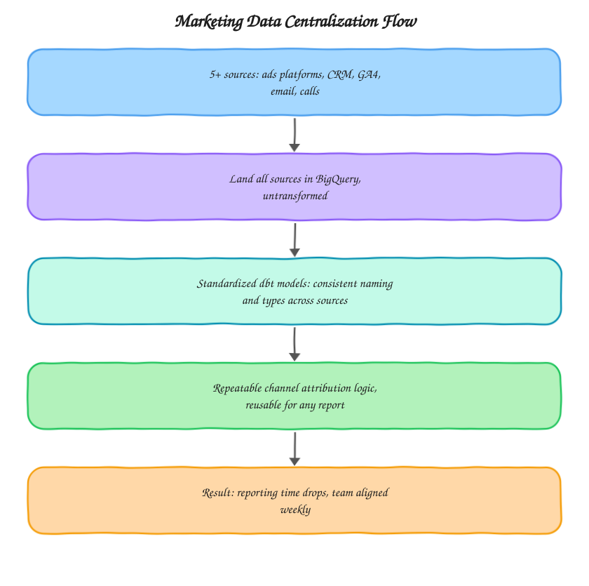

# Marketing Data Centralization

A standardization layer for pulling five or more marketing and CRM sources into BigQuery under one consistent naming and typing convention, so channel attribution logic only has to be written once. Built from the kind of centralization work I do at [motabar.builds.stuff](https://motabarbuildstuff.com/) for growth-focused teams whose data is scattered across every tool they've adopted along the way.

## The problem this solves

By the time a company has 5+ marketing tools in play, every one of them has its own name for the same concept, source versus channel versus medium, lead versus contact versus deal, and its own date format and currency handling. Centralizing the raw data into one warehouse solves the "where is it" problem, but without a standardization layer on top, every new report still has to rediscover and re-reconcile the same inconsistencies. This project is that standardization layer, built once and reused everywhere.

## Architecture

The standardization models are deliberately kept separate from any specific report's logic. A dashboard, an attribution model, and a CRM sync all read from the same standardized layer instead of each writing their own reconciliation logic, which is what makes the attribution logic genuinely repeatable rather than re-derived per project.

## What's in here

* `dbt_models/stg_standardized_channel_map.sql` maps every source's own channel and medium naming onto one consistent taxonomy
* `dbt_models/int_unified_marketing_crm.sql` joins the standardized channel data against CRM records using the shared taxonomy, producing one queryable layer for any downstream report

## How it's used in practice

The channel map model is the piece most centralization projects skip, and it's the one that actually saves the time. Every source lands with its own labels: Google Ads calls it `cpc`, HubSpot calls the same traffic `Paid Search`, and a manually tagged campaign might say `google-ads` with a hyphen. The mapping table resolves all of these to one canonical value before anything downstream ever joins across sources, so the join key is reliable instead of being a source of silent data loss.

## What good output looks like

`int_unified_marketing_crm.sql` should have a single, consistent value for channel and medium across every source, with no source-specific spelling variants leaking through, that's the signal that the mapping table is actually catching everything and not just the common cases.

## Setup

1. Land each source (ads platforms, CRM, GA4, email, call tracking) into its own raw BigQuery dataset
2. Populate `stg_standardized_channel_map.sql`'s mapping table with every raw label variant found across sources
3. Run `int_unified_marketing_crm.sql` to produce the unified, standardized layer
4. Point dashboards and attribution logic at this layer instead of any single raw source

## Stack

BigQuery, dbt, SQL

## Related

* Case study: [Single Source of Truth for Marketing Data](https://motabarbuildstuff.com/case-studies/single-source-of-truth-for-marketing-data/)
* Service: [Marketing analytics consulting](https://motabarbuildstuff.com/marketing-analytics-consultant/)

Built by [Motabar Javaid](https://motabarbuildstuff.com/about/), analytics engineer at [motabar.builds.stuff](https://motabarbuildstuff.com/).
